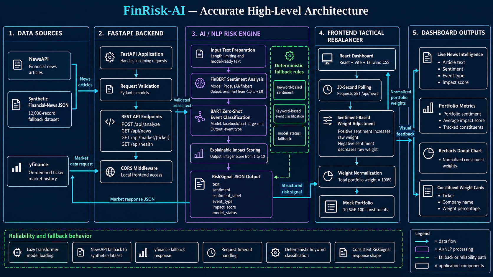

# FinRisk-AI — S&P Global & Crisil Campus Hackathon

| Candidate | Shivakant Kurmi |
|---|---|
| College Email ID | shivkant.23bcg10140@vitbhopal.ac.in |
| Personal Email ID | shivakantkurmi49@gmail.com |
| College / Campus | VIT Bhopal University |
| Demo Video Link | Pending — unlisted YouTube walkthrough |
**Slide Deck:** [docs/FinRisk-AI-Presentation.pptx](docs/FinRisk-AI-Presentation.pptx)

## 1. Project Overview

Financial markets react instantly to global news, making manual risk
assessment inefficient. FinRisk-AI converts unstructured financial news into
machine-readable risk signals:

- Sentiment score from `-1.0` to `+1.0`
- Sentiment label
- Event type
- Impact score from `1` to `10`
- Model status: `transformers` or `fallback`

The React dashboard uses these signals to demonstrate a tactical rebalancing
workflow for a mock portfolio of 10 S&P 100 constituents. Positive sentiment
increases a stock's raw weight, negative sentiment decreases it, and the final
weights are normalized to exactly `100%`.

> FinRisk-AI is a prototype for explainable risk intelligence. It does not
> provide investment advice or guarantee investment returns.

## 2. Architecture

The architecture diagram matches the current implementation: NewsAPI and the
synthetic JSON dataset feed the FastAPI service; the AI/NLP layer returns a
`RiskSignal`; and the React frontend performs the tactical weight adjustment
and normalization.



See the full diagram here: [docs/architecture.png](docs/architecture.png)

### Implemented data flow

```text
NewsAPI / synthetic JSON
              |
              v
FastAPI request validation and REST endpoints
              |
              v
FinBERT sentiment + BART event classification
              |
              v
RiskSignal JSON
              |
              v
React tactical rebalancer
              |
              v
Normalized portfolio weights and dashboard
```

Market data is fetched separately on demand:

```text
yfinance -> GET /api/market/{ticker} -> market response JSON
```

### Technology stack

| Layer | Implemented technology |
|---|---|
| Data sources | NewsAPI, yfinance, synthetic JSON |
| Backend | Python, FastAPI, Pydantic, CORS middleware |
| Sentiment model | `ProsusAI/finbert` |
| Event model | `facebook/bart-large-mnli` zero-shot classification |
| Fallback logic | Keyword-based sentiment and event classification |
| Frontend | React, Vite, Tailwind CSS |
| Visualization | Recharts donut chart and constituent weight cards |

### Backend endpoints

| Method | Endpoint | Purpose |
|---|---|---|
| `GET` | `/api/health` | Health check |
| `POST` | `/api/analyze` | Analyze submitted article text |
| `GET` | `/api/news` | Fetch and analyze news articles |
| `GET` | `/api/market/{ticker}` | Fetch on-demand ticker history |

The backend uses lazy transformer loading, request timeouts, and deterministic
fallback behavior when external APIs or transformer models are unavailable.
The fallback path is rule-based; it is not a second AI model.

## 3. Dataset Used

### Financial news dataset

The repository includes
[`data/sample_financial_news.json`](data/sample_financial_news.json), a
12,000-record synthetic dataset. Each record contains:

- `id`
- `title`
- `source`
- `published_at`
- `expected_event`
- `expected_sentiment`
- `region`
- `ticker`

The dataset is used as the fallback news source when `NEWS_API_KEY` is not
configured or NewsAPI is unavailable.

### Market data

The backend uses `yfinance` for on-demand ticker history through
`GET /api/market/{ticker}`. Market data is not required for the dashboard
rebalance demo; it is exposed as a separate backend data endpoint.

### Portfolio assumptions

- The mock portfolio contains 10 S&P 100 constituents.
- Baseline raw weight is equal for every constituent.
- Sentiment adjusts each stock's raw weight.
- Final weights are normalized to `100%`.

## 4. Quickstart and Installation

### Requirements

- Python `3.10+`
- Node.js `20+`
- npm

### Clone the repository

```powershell
git clone https://github.com/shivakantkurmi/VITBhopal-ShivakantKurmi-hackathon.git
cd VITBhopal-ShivakantKurmi-hackathon
```

### Start the backend

Open PowerShell terminal 1:

```powershell
cd src\api
python -m pip install -r ..\..\requirements.txt
python -m uvicorn main:app --reload --port 8000
```

Backend URLs:

- API health: <http://localhost:8000/api/health>
- Interactive API documentation: <http://localhost:8000/docs>

### Start the frontend

Open PowerShell terminal 2:

```powershell
cd src\dashboard
npm install
npm run dev
```

Open the dashboard at <http://localhost:5173/>.

The dashboard polls `GET /api/news` every 30 seconds. If the backend is
unavailable, it displays the built-in synthetic fallback signals.

### Optional NewsAPI configuration

The backend works without an API key. To enable live NewsAPI articles, set the
environment variable before starting the backend:

```powershell
$env:NEWS_API_KEY = "your_newsapi_key"
python -m uvicorn main:app --reload --port 8000
```

Never commit API keys or `.env` files.

## 5. Example API Request

Request:

```http
POST http://localhost:8000/api/analyze
Content-Type: application/json
```

```json
{
  "text": "Technology sector reports strong quarterly earnings growth"
}
```

Example response:

```json
{
  "text": "Technology sector reports strong quarterly earnings growth",
  "sentiment": 0.5,
  "sentiment_label": "positive",
  "event_type": "Corporate Earnings",
  "impact_score": 4,
  "model_status": "fallback"
}
```

When the transformer dependencies and model files are available, the response
reports `"model_status": "transformers"`. Otherwise, the deterministic
keyword-based fallback produces the same response shape.

## 6. Results and Domain Impact

### Demonstrated results

- Converts article text into structured risk signals.
- Supports sentiment values from `-1.0` to `+1.0`.
- Produces impact scores from `1` to `10`.
- Displays live news intelligence in the dashboard.
- Rebalances 10 constituent weights.
- Keeps total portfolio allocation at exactly `100%`.

### Domain impact

FinRisk-AI demonstrates how portfolio teams can move from unstructured market
information to a timely, explainable tactical allocation signal. The output
provides a consistent reason for a simulated portfolio adjustment:
sentiment + event type + impact score.

## 7. Submission Deliverables

| Deliverable | Location | Status |
|---|---|---|
| Source code and setup instructions | This public GitHub repository | Ready |
| Presentation deck, 5–7 slides | [docs/FinRisk-AI-Presentation.pptx](docs/FinRisk-AI-Presentation.pptx) | Ready |
| Architecture flow diagram | [docs/architecture.png](docs/architecture.png) | Ready |
| Synthetic and prototype data | [`data/`](data/) | Ready |
| Demo video walkthrough | Unlisted YouTube link | Pending recording |

The demo video should show:

1. The running FastAPI health endpoint.
2. A `POST /api/analyze` request.
3. The `/api/news` response and fallback behavior.
4. The React dashboard.
5. News sentiment, event type, and impact score cards.
6. The resulting normalized portfolio weights.

## 8. License

This project is available under the [MIT License](LICENSE).
